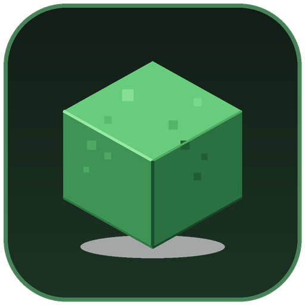
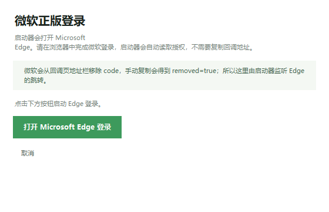
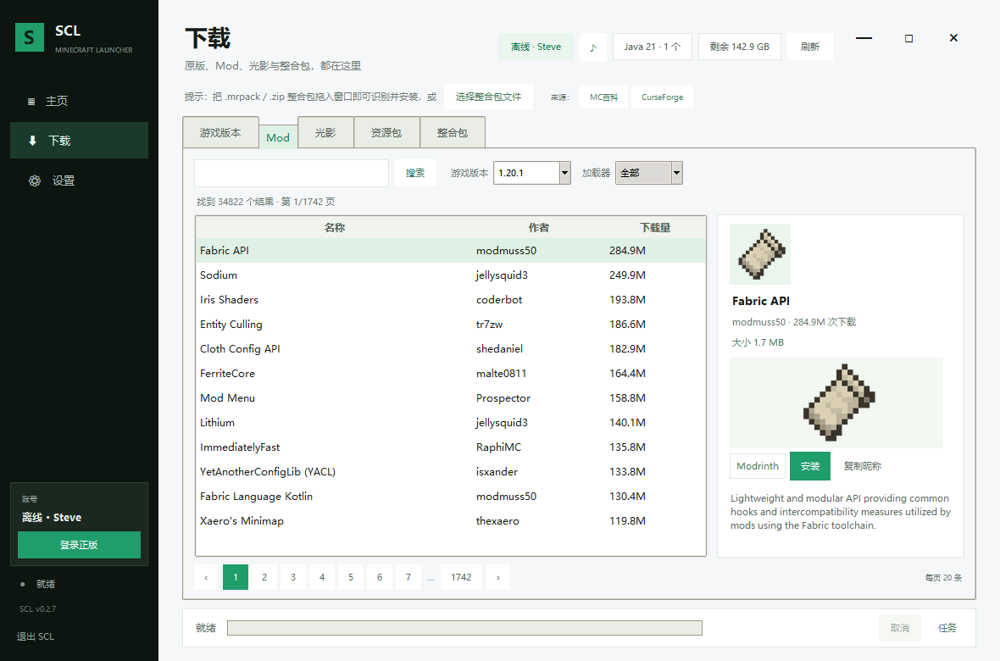
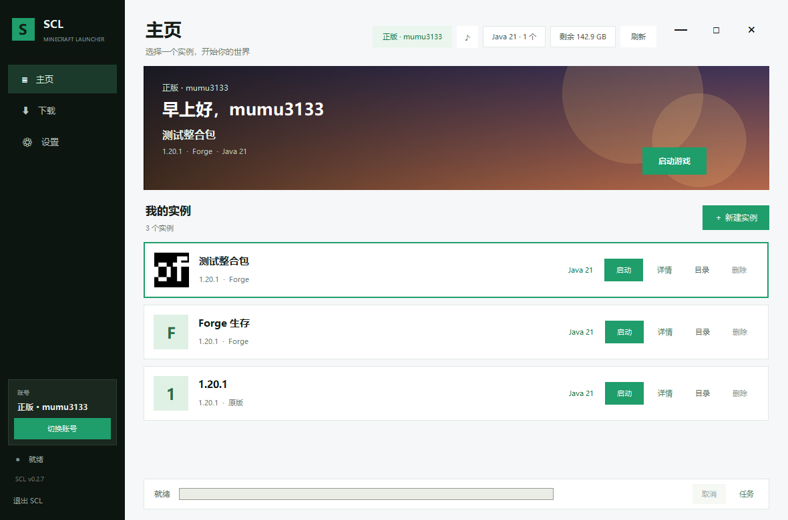
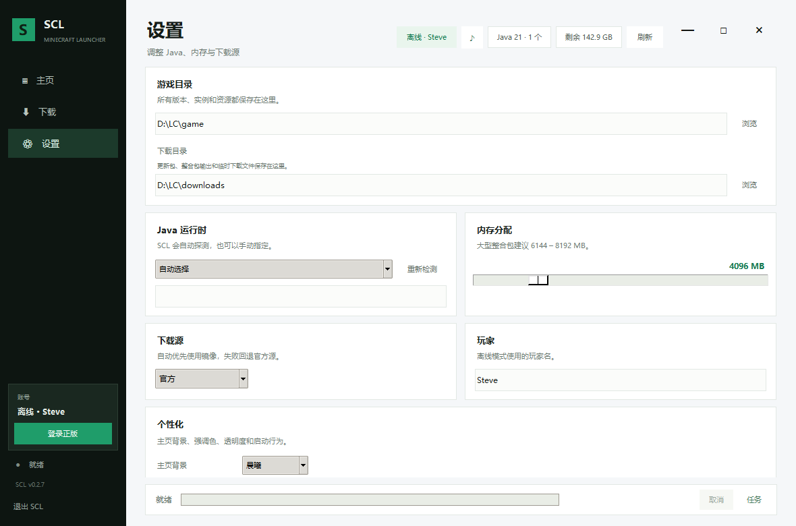
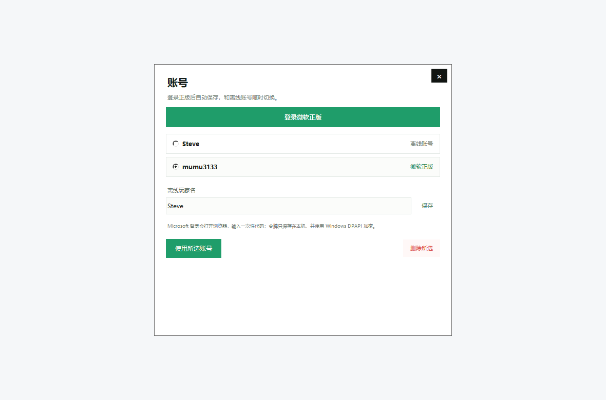
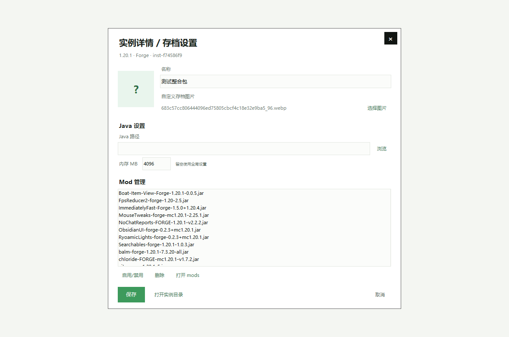

# Simple Cube Launcher (SCL)

一个面向 Windows 的原生 Minecraft 启动器：双击 exe 直接弹出桌面窗口，不经过浏览器、不弹终端，也不需要安装 Python。

Windows x64 · v0.2.8 · MIT License

软件内部统一显示为 **SCL**；窗口标题、exe 文件名、发布包等外部信息使用完整名称 **Simple Cube Launcher**。

## 这一版

- **品牌更新**：软件内显示 SCL，窗口标题和 exe 使用 Simple Cube Launcher，版本 0.2.8。
- **稳定性修复**：移除启动透明/缩放、内容截图淡化和 Configure 强制重绘，避免调整窗口或切页时整屏黑闪。
- **拖放稳定性**：拖入整合包不再弹确认框；支持 `.mrpack`、Modrinth zip、CurseForge manifest zip 和普通 zip。
- **界面更新**：冷色浅底、深石墨侧栏、新款强调色、圆角控件、现代 Treeview 行高；窗口按钮更小更紧凑。
- **复选框**：设置里的勾选改为无阴影扁平方框。
- **圆润控件**：所有 tk.Button 改为 Canvas 自绘圆角按钮；右上角三个按钮取消黑色块，只保留加粗黑色图标。
- **直接退出**：关闭按钮和“退出 SCL”不再弹确认框；设置改为修改即自动保存，移除“保存设置”。
- **弹层动画**：页内弹层从小到大的缩放出现。
- **实例目录**：实例文件夹使用实例名称（重名自动加后缀），并迁移旧的 inst- 目录。
- **更新 / 发布 / 下载目录**：新增静态 update.json 更新检查、整合包 .mrpack 发布、下载目录设置；客户端下载 8 路 Range、资源 24 并发。

- **边缘缩放**：移除右下角 ◢ 手柄；鼠标移到窗口四边/四角自动变成缩放光标，可直接拖拽调整大小。
- **页内弹层**：除微软正版授权外，账号、新建实例、项目详情、实例详情、图片预览、任务详情全部改为启动器内部弹层，不再新开窗口。
- **动效精简**：移除启动、切页、下载标签和版本选择的动画；保留页内弹层的缩放出现。
- **视觉统一**：右上角窗口按钮改为无边框黑色图标，尺寸更紧凑；滚动条改成窄条极简样式。
- **下载提速**：Minecraft 客户端启用 8 路 Range 分段并发，资源/运行库并发 24；保留镜像优先和失败回退。

- **下载页重构**：资源包移到光影后；Mod / 光影 / 资源包 / 整合包改为页码翻页，取消“加载更多”。
- **右侧预览**：显示项目大小，简介改为可滚动；底部改为来源、安装、复制昵称三个按钮。
- **外部来源**：提供 MC百科 / CurseForge 搜索入口和来源菜单；直接安装仍只支持 Modrinth。
- **实例详情**：可改名称、Java、内存，管理 Mod（启用/禁用/删除），自定义实例图片。
- **窗口与动效**：无边框窗口可自由缩放；已移除启动、页面和标签滑入动画，只保留弹层缩放。
- **无边框窗口**：彻底移除系统标题栏，最小化 / 最大化 / 关闭按钮在主页右上角；四边/四角拖拽缩放。
- **中国时间问候**：按 UTC+8 自动显示 凌晨好 / 早上好 / 上午好 / 中午好 / 下午好 / 晚上好。
- **拖入整合包**：把 .mrpack 文件拖进窗口即可识别并安装；下载页也提供“选择整合包文件”按钮和提示。
- **正版登录修复**：自动打开 Edge 并捕获授权码，走 Xbox Live、XSTS、Minecraft Services；client_id 为 00000000402b5328。

## 正版登录（0.2.8 自动 Edge）

前两版的失败点：

- 0.2.0：cmd start 截断 URL，AADSTS900144 缺少 scope。
- 0.2.1：desktop.srf 会从地址栏移除 code，手动复制只剩 removed=true。

0.2.8 改为启动 Microsoft Edge 的远程调试端口，在页面移除 code 之前从跳转请求中捕获授权码；同时把 Xbox Live 的 RpsTicket 改为原始 MSA token。

1. 点左侧栏“登录正版”。
2. 启动器自动打开 Microsoft Edge。
3. 在 Edge 中完成微软登录。
4. 授权成功后自动读取 Minecraft 档案并保存账号，Edge 自动关闭。

不需要复制回调地址。完整链路已实测成功。

## 下载与图片预览

下载页顶部提示：**把 .mrpack 整合包拖入窗口即可识别并安装**。也可以点“选择整合包文件”手动选择。

- 游戏版本：正式版 / 快照，版本筛选，一键安装。
- Mod：按游戏版本和 Fabric / Forge / NeoForge 筛选 Modrinth。
- 光影：按游戏版本搜索，下载到实例的 shaderpacks/。
- 整合包：解析 .mrpack，自动创建实例、安装加载器和全部文件；支持 Modrinth 在线整合包和本地 .mrpack。
- 资源包：搜索 Modrinth resourcepack，安装到实例的 resourcepacks/。
- **分页**：Mod、光影、资源包、整合包每页 20 条，使用页码翻页，不再有“加载更多”。
- 选中任意项目后，右侧显示项目图标、作者、下载量、项目大小、可滚动简介和画廊首图；底部是来源 / 安装 / 复制昵称三个按钮。
- 来源菜单可打开 Modrinth、MC百科搜索、CurseForge 搜索；MC百科和 CurseForge 目前是外部搜索入口，直接安装仍只支持 Modrinth。
- 图片下载带本地缓存，第二次打开不用重新下载。

## 界面

- 没有系统标题栏，右上角是黑色无边框的关闭 / 最小化 / 最大化按钮；鼠标移到四边/四角即可调整窗口大小。
- Hero 区域显示当前账号、中国时间问候、选中实例、版本 / 加载器 / Java。
- 左侧栏账号卡：离线时直接显示“登录正版”，正版时显示“切换账号”。
- 实例卡片保留启动、详情、目录、删除；底部日志跟随当前实例。
- 窗口无系统标题栏，可自由调整大小；右上角三个控制按钮分组对齐，切页有轻微滑入动画。
- 主页背景支持森林 / 晨曦 / 夜色 / 简约 / 自定义图片。
- 背景音乐支持 mp3 / ogg / wav、音量、自动播放；标题栏 ♪ 可快速播放/暂停。
- 强调色、窗口透明度、日志显示、启动后最小化等设置保留。

### 发布与自动更新

- 发布包会在 exe 同级附带 `update_url.txt`，指向最新 GitHub Release 的 `update.json`。
- 启动器优先读取设置里的更新 URL，其次读取 `update_url.txt`。
- 发布流水线会自动生成 zip、SHA256SUMS.txt、update.json，并附加到 Release。
- 具体发布步骤见 [docs/RELEASE.md](docs/RELEASE.md)。

### 整合包发布 / 更新

- 设置 → 发布与更新：填写静态 `update.json` 地址，启动器启动时检查并在右上角显示“更新 vX”。
- 更新包下载到下载目录，校验 SHA256 后通过 `robocopy` 替换程序目录；账号、配置、实例不会被覆盖。
- 设置 → 整合包发布：选择实例、名称、版本和输出位置，生成带 `modrinth.index.json` + `overrides/` 的 `.mrpack`。
- 下载目录只用于更新包、整合包输出和临时下载；Minecraft 的运行库/资源仍需放在游戏目录内以保持版本兼容。
- 示例清单：[docs/update.example.json](docs/update.example.json)。

### 设置与外观

- 修改设置即自动保存，没有保存按钮。
- 设置里包含下载目录、更新清单 URL、整合包发布入口。

### 页内弹层

除微软授权外，账号、新建实例、项目详情、实例详情、图片预览、任务详情都使用主窗口内的弹层，不再打开新的系统窗口。

### 实例详情

- 修改实例名称、自定义图片。
- 单独设置 Java 路径和内存（留空使用全局）。
- Mod 管理：启用/禁用、删除、打开 mods。
- 保存后实例卡片立即更新，启动时使用实例自己的 Java/内存。

## 已经实现

### 原版
- Mojang 官方版本清单（正式版 / 快照）。
- client.jar、运行库、资源文件、日志配置，SHA1 校验，缓存跳过。
- 下载源：自动 / BMCLAPI 镜像 / 官方。

### 加载器
- Fabric：Fabric Meta，自动选稳定版本。
- Forge：无头运行官方安装器。
- NeoForge：无头运行官方安装器。

### 内容（Modrinth）
- Mod、光影、整合包、资源包搜索与安装。
- 安装前按实例的游戏版本与加载器过滤。
- 整合包自动安装原版 + 加载器，并展开 overrides / client-overrides。
- 本地 .mrpack 支持拖放和文件选择。
- 项目图标和画廊预览，本地图片缓存。

### 启动
- 版本继承（Fabric / Forge inheritsFrom）。
- Java 自动探测与版本检查。
- 按当前架构解压 natives（x64 / x86 / arm64）。
- 离线 / 正版账号启动参数。
- 每个实例独立 gameDir，Mod、光影、资源包、存档互不干扰。

## 从源码运行 / 构建 exe

需要 Windows 和 Python 3.10+。

    # 安装界面/音乐依赖
    python -m pip install -r requirements.txt

    # 直接运行源码
    python gui.py

    # 构建 exe（会创建 .venv）
    .\build.ps1

    # 或者指定 Python 启动器
    .\build.ps1 -Python py

构建结果：

    dist/SimpleCubeLauncher/SimpleCubeLauncher.exe
    dist/SimpleCubeLauncher/_internal/

图标和版本资源在：

    assets/icon.ico
    assets/icon.png
    version_info.txt

## 发布到 GitHub

仓库已经包含 GitHub Actions 工作流：.github/workflows/build.yml。

推送一个版本标签即可自动构建并生成 Release 附件：

    git init
    git add .
    git commit -m "Simple Cube Launcher 0.2.8"
    git tag v0.2.8
    git remote add origin https://github.com/<你的用户名>/<仓库名>.git
    git push -u origin main
    git push origin v0.2.8

工作流会：

1. 在 windows-latest 安装 Python 3.12、Pillow、pygame、websocket-client 和 PyInstaller。
2. 构建 onedir 版的 SimpleCubeLauncher.exe。
3. 打包 SimpleCubeLauncher-v0.2.8-win64.zip。
4. 上传 artifact，并在 tag 发布时附加到 GitHub Release。

建议在正式发布前：

- 为 exe 做代码签名，减少 SmartScreen 提示。
- 用真实微软账号走一遍正版登录，确认账号地区 / Xbox 档案状态。
- 在 README 加上 Releases 链接。

## 目录结构

    D:\LC/
    ├─ SimpleCubeLauncher/                 # 本地可直接运行的软件目录
    │  ├─ SimpleCubeLauncher.exe           # 带图标、无终端的 exe
    │  ├─ _internal/                       # Python / Tk / Pillow / pygame / 资源
    │  ├─ config.json                      # 本地便携配置
    │  ├─ accounts.json                    # 账号（令牌 DPAPI 加密）
    │  └─ portable.txt                     # 便携模式标记
    ├─ SimpleCubeLauncher-0.2.8-win64.zip  # 发布包
    ├─ gui.py                              # 原生 Tk 界面
    ├─ launcher/                           # 核心逻辑、微软认证、DPAPI
    ├─ assets/                             # 图标、主页背景
    ├─ docs/                               # 截图
    ├─ build.ps1                           # 构建脚本
    ├─ requirements.txt                    # Pillow / pygame
    ├─ requirements-build.txt              # PyInstaller
    ├─ version_info.txt
    ├─ .github/workflows/build.yml
    ├─ main.py                             # 可选的网页版
    └─ game/                               # 本地游戏数据

## 已验证

- **SCL 界面自检**：3 个实例，SELFTEST-UI hits=20 preview=True image=True hero=True music=True settings=True。
- **窗口控制**：最小化 / 最大化 / 关闭已集成在右上角，尺寸更大、分组对齐；窗口无系统标题栏。
- **问候语**：04:xx 实测显示“凌晨好，Steve”（按 UTC+8）。
- **拖放提示**：下载页显示 .mrpack 拖入提示和“选择整合包文件”按钮；拖放使用 Windows WM_DROPFILES。
- **完整正版登录**：Edge 自动捕获 code → Live token → Xbox Live → XSTS → Minecraft profile 全链路实测成功，读取到玩家档案和 entitlements。
- **登录入口**：左侧栏账号卡和账号窗口顶部都有登录正版入口；点击后自动打开 Edge，不再需要复制回调 URL。
- **打开目录**：explorer.exe 直接打开，浏览器打开有 cmd start / webbrowser / os.startfile 三级回退。
- **无边框窗口**：系统标题栏完全移除；窗口扩展样式包含 WS_EX_APPWINDOW，任务栏可见；最大化 / 最小化实测通过。
- **窗口置顶**：topmost 为 False，点击其他窗口会正常递进。
- **原版 1.20.1**：3575 个资源文件完整安装并启动到标题界面。
- **Forge 1.20.1 47.4.10**：安装器无头安装成功，JEI 正常加载。
- **整合包**：Optimized fps（22 个文件，Forge）安装完成并启动，25 个 Mod 加载。
- **Mod / 光影 / 资源包**：Modrinth 搜索、筛选、下载到实例均通过。

## 已知限制

- **微软完整登录需要你的账号**：完整链路已实测成功，但首次登录仍需要你在 Edge 中输入自己的微软账号。
- **登录依赖 Microsoft Edge**：Windows 10/11 自带；若系统没有 Edge，登录会提示找不到浏览器。
- **Fabric**：安装与内容下载已实现；Fabric 第一次启动要在 .fabric 下写重映射 jar，本机开发沙箱的 Java 会把它判定为不可写，因此 Fabric 启动未能在沙箱内完成。普通用户权限通常没问题。
- **背景音乐**：exe 内包含 pygame，自检确认组件可用；实际音频输出取决于系统音频设备。
- 暂不支持 Quilt 加载器 / Quilt 整合包。
- 光影只下载到 shaderpacks/，需要在实例里安装 Iris 或 OptiFine。
- exe 未做代码签名，首次运行可能出现 Windows SmartScreen 提示。
- 仅提供 Windows x64 构建。

## License

MIT License，见 LICENSE。
